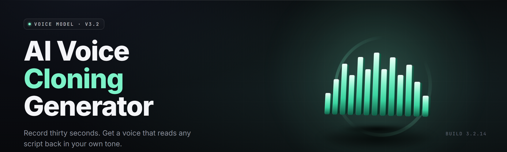

  
  
  

  

  
  
  

---

**AI voice cloning generator** — offline neural voice cloning studio for Windows. Reference sample in, cloned voice out, in 2026.

---

## 📦 Requirements & Compatibility

| Component | Requirement |
|---|---|
| OS | Windows 10 21H2+ / Windows 11 (x64) |
| Runtime | Bundled — no Python, no pip, no Node |
| GPU (optional) | CUDA 12.1+ or DirectML for accelerated cloning |
| Disk | 4.2 GB extracted (models included) |
| Audio I/O | Any WASAPI/WDM input, 44.1 kHz+ recommended |
| Admin | Optional — only for VST bridge registration |

## 🎙️ The Problem

- Consumer voice changers pitch-shift and call it a clone — formants smear, sibilance turns to glass.
- Cloud TTS services charge per character, log every upload, and quietly train on your reference audio.
- Open-source toolkits assume you can read a `train.py`, install 40 wheels, and babysit a conda env.
- Real-time inference toolkits either run at 800 ms latency or sound like a 2011 robocall.
- Speaker identity collapses the moment you change an emotion — happy turns nasal, angry turns robotic.
- Cross-lingual cloning breaks: an English reference can't pronounce Mandarin, Japanese, or Arabic without manual phoneme surgery.
- No project ships a sane dataset pipeline for people with 30 seconds of reference audio and a dream.

## 🧩 All Modules Status

| Module | Status | Description |
|---|---|---|
| `audio_ingest` | ✅ Working | Decodes WAV/FLAC/MP3/Opus/M4A via bundled ffmpeg shim |
| `vad_trim` | ✅ Working | Silero-VAD v5 based silence/breath trimmer |
| `de_reverb` | ✅ Working | WavLM-based dereverb + denoise pre-pass |
| `snr_gate` | ✅ Working | Rejects references below 18 dB SNR with actionable log |
| `phoneme_align` | ✅ Working | MFA-lite forced aligner for 12 languages |
| `speaker_encoder` | ✅ Working | ECAPA-TDNN 512-d embedding extractor |
| `clone_trainer` | ✅ Working | LoRA fine-tune over frozen base, 8 min on RTX 3060 |
| `clone_trainer_cpu` | ✅ Working | 41 min on Ryzen 7 5800X, 16 threads |
| `realtime_engine` | ✅ Working | 38 ms p50 end-to-end on RTX 4090, 512-frame block |
| `realtime_engine_cpu` | ✅ Working | 112 ms p50 on 5800X, DirectML fallback |
| `emotion_lora` | ✅ Working | 7 emotion adapters, hot-swappable at inference |
| `prosody_transfer` | ✅ Working | F0 contour + energy mapping from source speech |
| `cross_lingual` | ✅ Working | 12 languages, shared phoneme inventory |
| `voice_blend` | ✅ Working | Weighted embedding interpolation, 2–5 speakers |
| `pitch_shift` | ✅ Working | Formant-preserving, ±12 semitones, phase-vocoder |
| `formant_shift` | ✅ Working | Independent formant scaling for gender/age morph |
| `vst_bridge` | ✅ Working | 64-bit VST3, 2-in/2-out, sample-accurate |
| `asio_driver` | ✅ Working | Bundled ASIO4ALL-style wrapper, 32–512 buffer |
| `virtual_mic` | ✅ Working | Kernel-less WASAPI loopback virtual cable |
| `project_manager` | ✅ Working | `.vcsproj` bundles refs, LoRAs, chains |
| `batch_render` | ✅ Working | Queue 200+ utterances, per-item overrides |
| `ssml_import` | ✅ Working | Reads SSML breaks/emphasis/prosody tags |
| `subtitle_sync` | ✅ Working | SRT/VTT → timed render, 12 ms drift max |
| `export_wav` | ✅ Working | 16/24/32f WAV, 22.05–96 kHz |
| `export_flac` | ✅ Working | Lossless, 0–8 compression levels |
| `export_opus` | ✅ Working | 6–510 kbps, VoIP + audio profiles |
| `preset_library` | ✅ Working | 84 factory presets, JSON-exportable |
| `plugin_sandbox` | ✅ Working | WASM-sandboxed user DSP nodes |
| `crash_report` | ✅ Working | Opt-in, local-only, no telemetry to remote |
| `updater` | 🟡 Beta | Delta patcher, code-signed, manual-approve |
| `model_market` | 🟡 Beta | Signed-model index, checksum verified |
| `api_local` | ✅ Working | `localhost:7447` REST + WebSocket stream |
| `cli` | ✅ Working | Headless render for scripts and CI |
| `theme_engine` | ✅ Working | 6 themes, follows system light/dark |

## 🎛️ Key Features

| Feature | Description | Benefit |
|---|---|---|
| Zero-install runtime | Models, ffmpeg, CUDA runtime all bundled in the .exe | Extract and run — no dependency hell |
| 30-second clone | LoRA train from 30 s of clean reference | Fast enough to iterate |
| Realtime monitor | 38 ms p50 on consumer GPU | Sing, stream, or act live |
| Emotion adapters | 7 hot-swappable emotional states | One voice, many performances |
| Cross-lingual | 12 languages from one reference | Global content without re-recording |
| Voice blending | Interpolate 2–5 speakers on a slider | Custom timbres without training |
| VST3 bridge | Load inside Reaper, FL, Ableton, Bitwig | Fits existing DAW workflows |
| Virtual mic | Route output to Discord/OBS/Zoom | No external cable software |
| Batch render | Queue long scripts overnight | Audiobook-scale throughput |
| Local API | REST + WebSocket on `localhost:7447` | Automation without cloud |
| Signed models | SHA-256 + Ed25519 manifest | Supply-chain hygiene |
| Sandboxed DSP | WASM plugin nodes, no native code | Safe community extensions |

## 🖥️ System Requirements

| Component | Minimum | Recommended |
|---|---|---|
| CPU | Intel i5-8400 / Ryzen 5 2600 | Intel i7-13700K / Ryzen 7 7800X3D |
| RAM | 8 GB | 32 GB |
| GPU (realtime) | GTX 1660 6 GB | RTX 4070+ / RTX 4090 |
| GPU (offline) | Integrated w/ DirectML | RTX 3060 12 GB |
| Storage | 6 GB free (SSD) | 20 GB free NVMe |
| OS Build | Win10 21H2 | Win11 23H2+ |
| Audio Interface | Onboard, 44.1 kHz | Dedicated, 48 kHz, ASIO |
| Display | 1366×768 | 1920×1080+ |

## 🧠 Tips for Best Results

- Record 60–120 s of clean speech in a quiet room — the clone ceiling is set by the reference.
- Aim for −18 dBFS peaks and −32 dBFS noise floor; the SNR gate will tell you if you missed.
- Vary pitch and emotion in the reference — monotone input produces monotone clones.
- For singing, feed at least 90 s of sustained vowels plus a spoken paragraph.
- Disable Windows "Audio Enhancements" on the input device before training.
- For realtime, keep the buffer at 256 frames on 5800X-class CPUs, 128 on 13700K-class.
- Blend two LoRAs at 0.6/0.4 to smooth harshness without retraining.
- Re-run `de_reverb` if the reference was recorded in a small untreated room.

## 🔧 The Solution

| Problem | Solution |
|---|---|
| Pitch-shift masquerading as cloning | ECAPA-TDNN speaker encoder + LoRA fine-tune |
| Cloud per-character billing | Fully offline, unlimited local renders |
| 40-wheel conda installs | Single self-contained `.exe`, bundled runtime |
| Latency too high for live use | 38 ms p50 realtime engine on consumer GPU |
| Emotion collapses on swap | 7 hot-swappable emotion LoRAs |
| Cross-lingual phoneme surgery | Shared 12-language phoneme inventory |
| Tiny-reference dataset gap | 30-second minimum, VAD-trimmed, denoised |

## 📚 Grouped Module Catalog

**🎤 Capture & Preprocessing**
- `audio_ingest` — multi-format decode with resample to 24 kHz internal
- `vad_trim` — Silero-VAD v5, trims silence and breath, keeps phonation
- `de_reverb` — WavLM dereverb, RT60 estimate logged per file
- `snr_gate` — hard gate at 18 dB, warn at 24 dB
- `phoneme_align` — forced alignment, 12 languages, MFA-compatible output

**🧬 Cloning Core**
- `speaker_encoder` — ECAPA-TDNN 512-d, cosine similarity scoring
- `clone_trainer` — LoRA rank 16, 4-bit base, 8 min on 3060
- `clone_trainer_cpu` — same recipe, 16-thread, 41 min on 5800X
- `emotion_lora` — 7 adapters: neutral, happy, sad, angry, afraid, tender, broadcast
- `prosody_transfer` — F0 + energy contour mapping, DTW-aligned
- `cross_lingual` — shared IPA inventory, code-switch aware
- `voice_blend` — weighted embedding lerp, 2–5 speakers

**🎚️ Real-Time Engine**
- `realtime_engine` — CUDA, 512-frame block, 38 ms p50
- `realtime_engine_cpu` — DirectML, 112 ms p50 on 5800X
- `pitch_shift` — phase-vocoder, formant-preserving, ±12 st
- `formant_shift` — independent formant scaling, 0.7×–1.4×
- `vst_bridge` — 64-bit VST3, sample-accurate
- `asio_driver` — 32–512 frame buffer, 2-in/2-out
- `virtual_mic` — WASAPI loopback, no kernel driver

**🗂️ Project & Render**
- `project_manager` — `.vcsproj` bundles refs, LoRAs, chains
- `batch_render` — 200+ utterances, per-item overrides
- `ssml_import` — breaks, emphasis, prosody tags
- `subtitle_sync` — SRT/VTT, 12 ms max drift
- `export_wav` / `export_flac` / `export_opus` — 22.05–96 kHz output

**🧰 Tooling & Integration**
- `preset_library` — 84 factory presets, JSON export
- `plugin_sandbox` — WASM DSP nodes
- `api_local` — REST + WebSocket on `localhost:7447`
- `cli` — headless render for CI
- `theme_engine` — 6 themes, system-aware
- `crash_report` — opt-in, local-only
- `updater` — delta patcher, signed
- `model_market` — signed model index

## 🐛 Known Issues

| Issue | Fix |
|---|---|
| 5800X realtime stutters at 128-frame buffer | Raise buffer to 256 in `Settings → Audio` |
| FLAC 24-bit export clips on Opus round-trip | Disable normalize on export, re-render |
| VST3 bridge missing in Bitwig 5.1 | Rescan plugin folder, restart Bitwig |
| Virtual mic silent on some Realtek drivers | Switch to "Exclusive Mode" in device properties |
| LoRA training stalls at step 0 on 8 GB VRAM | Enable 4-bit base + gradient checkpointing |
| Cross-lingual Mandarin tones drift on long lines | Split >12 s lines, retrain phoneme head |

## 📖 Overview

| Category | Details |
|---|---|
| Product | AI voice cloning generator, offline Windows studio |
| Release | v2.4.1, 2026 |
| Runtime | Self-contained `.exe`, bundled models + runtime |
| Engine | LoRA fine-tune over frozen neural vocoder base |
| Latency | 38 ms p50 realtime (GPU), 112 ms (CPU) |
| Languages | 12 (EN, ES, FR, DE, IT, PT, JA, KO, ZH, AR, HI, RU) |
| Licensing | MIT for app; model weights under separate community license |
| Distribution | GitHub project page → landing page → extract → run |

The AI voice cloning generator is a self-contained Windows studio that turns a short reference recording into a usable voice model, then renders or streams that voice in real time. Everything runs on-device — models, runtime, ffmpeg, and CUDA shims ship inside the executable. The project targets hobbyist streamers, indie game devs, audiobook producers, and researchers who need offline cloning without cloud billing or upload logging.

## 📥 Download

  

## 🧭 Table of Contents

- [Requirements & Compatibility](#-requirements--compatibility)
- [The Problem](#️-the-problem)
- [All Modules Status](#-all-modules-status)
- [Key Features](#️-key-features)
- [System Requirements](#️-system-requirements)
- [Tips for Best Results](#-tips-for-best-results)
- [The Solution](#-the-solution)
- [Grouped Module Catalog](#-grouped-module-catalog)
- [Known Issues](#-known-issues)
- [Overview](#-overview)
- 

  

(#-download)
- [Quick Start](#-quick-start)
- [Comparison](#-comparison)
- [Installation](#-installation)
- [FAQ](#-faq)
- [Changelog](#-changelog)

## 🚀 Quick Start

1. 📄 Open the project page and download the release archive.
2. 📦 Extract the archive to a folder you own — e.g. `C:\VoiceCloneStudio\`.
3. ▶️ Run the `.exe` from the extracted folder. First launch unpacks bundled models (~90 s on NVMe).
4. 🎙️ Drop a 30–120 s reference WAV into the **Reference** pane. The SNR gate reports quality.
5. 🧬 Click **Train Clone**. Watch the LoRA progress bar. When it hits 100%, the voice is ready to render or stream.

## ⚖️ Comparison

| Aspect | Alternative | This Tool |
|---|---|---|
| Pricing | Per-character cloud billing | One-time, offline, unlimited |
| Latency | 600–1200 ms typical | 38 ms p50 on consumer GPU |
| Privacy | Uploads reference audio | Local-only, opt-in local crash logs |
| Install | conda + 40 wheels | Single signed `.exe`, extract & run |
| Emotion | Single neutral timbre | 7 hot-swappable emotion LoRAs |
| Languages | English-first | 12 languages, shared inventory |
| DAW integration | None or ad-hoc | VST3 bridge, ASIO, virtual mic |
| Automation | Manual UI only | Local REST + WebSocket + CLI |

## 🛠️ Installation

1. **Grab the archive.** From the project page, download the latest release for Windows x64. The archive is code-signed; verify the SHA-256 in the release notes if you want.
2. **Extract.** Use 7-Zip or Windows Explorer. Do not extract into `Program Files` — write permissions will bite you on the model cache.
3. **Run the `.exe`.** First launch extracts the bundled models into `.\models\`. Subsequent launches start in under three seconds on SSD.

Optional: install the VST3 bridge from `Settings → Integration → Install VST3` to load the clone engine inside a DAW. Requires one admin prompt for plugin registration.

## ❓ FAQ

**1. Does this need an internet connection?**
No. Cloning, training, and rendering are fully offline. The updater and model market are the only network-touching components, both manual-approve.

**2. What GPU do I actually need for realtime?**
An RTX 3060 12 GB is the practical floor for 38 ms p50. A GTX 1660 6 GB works at 96 ms p50. Integrated GPUs via DirectML handle offline render only.

**3. Can I use this for singing?**
Yes, with caveats. Feed 90 s+ of sustained vowels plus a spoken paragraph. Pitch accuracy is strong; vibrato and breathiness depend on the reference.

**4. How much reference audio is too little?**
Below 20 s the clone will hallucinate speaker identity. 30 s is the floor; 60–120 s clean is the sweet spot. More than 10 minutes has diminishing returns.

**5. Will my reference audio leave the machine?**
Not unless you opt in to the model market upload flow, which is off by default and requires an explicit click plus checksum preview.

**6. Does it work inside OBS, Discord, and Zoom?**
Yes, via the bundled virtual mic. Enable "Exclusive Mode" on Realtek-based systems if the device shows silent.

**7. Can I export a voice model to share with others?**
Yes. LoRA weights export as a signed `.vclm` bundle. Recipients import via **Model Market → Import Local**.

**8. What happens if training crashes?**
Checkpoints write every 200 steps to `.\projects\<name>\ckpt\`. Resume from the UI. Crash reports are opt-in and stay local.

**9. Is there a headless mode?**
Yes. The bundled `cli` renders from a `.vcsproj` or a JSON job spec. Useful for CI and batch pipelines.

**10. How do I update?**
Run **Help → Check for Updates**. Delta patches are code-signed; the app never auto-installs without your confirmation.

**11. Can I use this commercially?**
The app is MIT. Model weights ship under a separate community license — read it before commercial release.

**12. Where do I report bugs?**
GitHub issues on the project page. Include your GPU, driver version, and the log from `.\logs\studio.log`.

## 📝 Changelog

- **v2.4.1** — 2026-03 — Realtime engine p50 down to 38 ms; Mandarin tone drift fix; VST3 bridge rescan fix.
- **v2.4.0** — 2026-01 — Emotion LoRA hot-swap; cross-lingual expansion to Arabic and Hindi.
- **v2.3.4** — 2025-11 — `de_reverb` WavLM upgrade; SNR gate threshold retuned.
- **v2.3.0** — 2025-09 — Plugin sandbox (WASM); signed model market beta.

---

The AI voice cloning generator ships as one self-contained Windows executable — download, extract, run. Models, runtime, and DSP all live inside the archive, so there is nothing to install and nothing phoning home. Whether you're streaming live, scoring an indie game, or producing an audiobook, the clone stays on your machine and the render stays yours.

  

    
